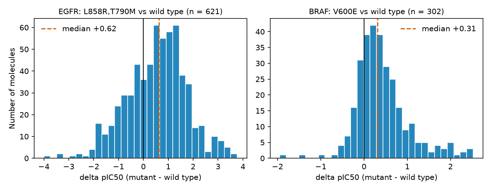
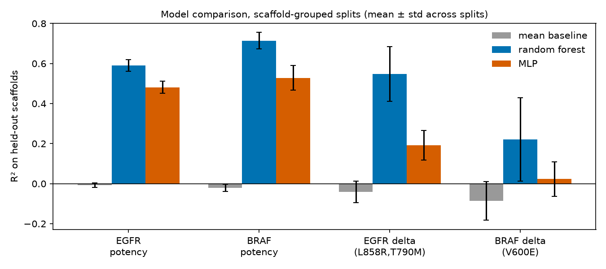
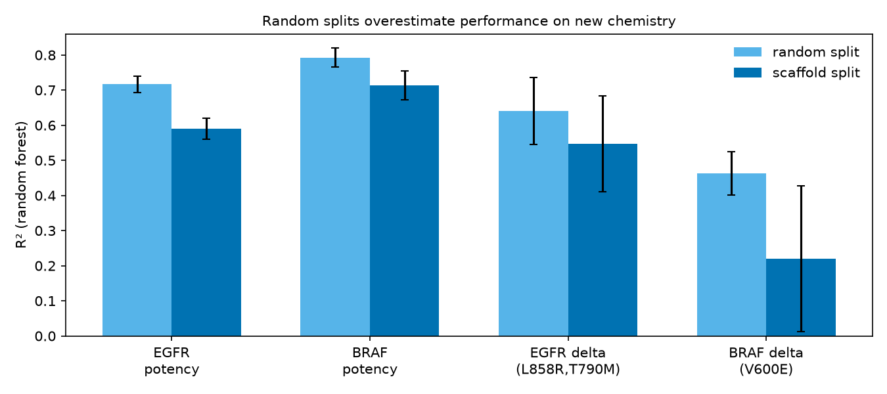
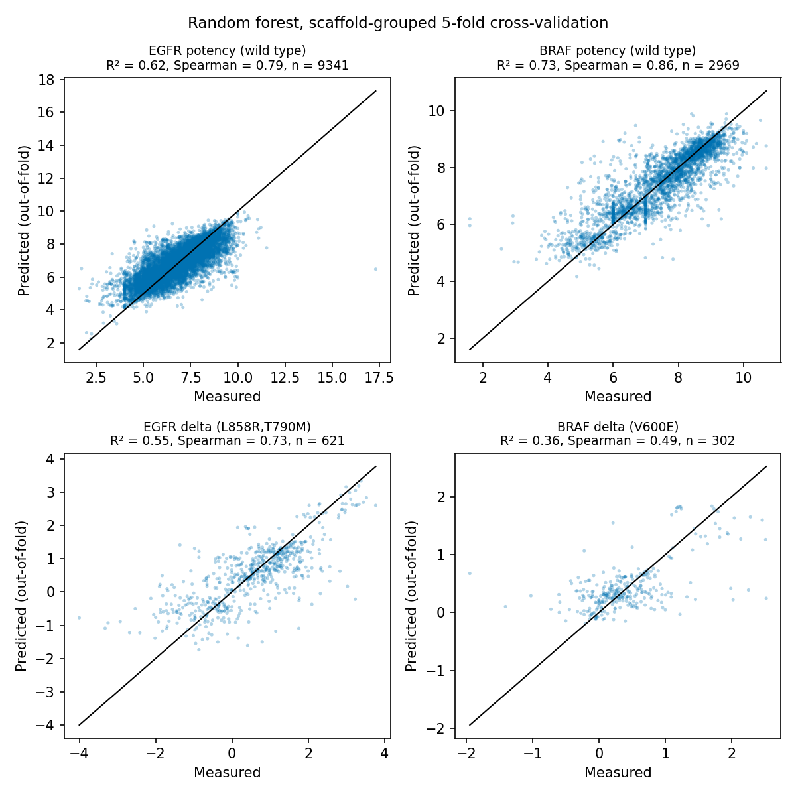

# Kinase potency and resistance-risk prediction for EGFR and BRAF (RDKit + scikit-learn + PyTorch)

A small project that:
(1) builds a baseline model of kinase inhibitor potency from chemical structure, and
(2) extends it to a simple proxy for **resistance risk**: how much a compound loses potency
against a clinically relevant mutant compared with the wild-type kinase.

The emphasis is on honest evaluation, using scaffold-grouped cross-validation, and on stating
clear limits.

> **Status:** In progress. A learning project on cheminformatics and machine learning for
> kinase drug discovery. After reading about the ANA-KIN doctoral network and its work on
> kinase drug discovery beyond the ATP site, I wanted to apply what I learned in my master's
> in computational biology to a related problem.

## Questions
1. Can models trained on known inhibitors predict the potency of **chemically new**
   compounds for EGFR and BRAF, and how much does the evaluation split change the answer?
2. Can the loss of potency against a mutant (a resistance proxy) be predicted from structure?

## Data
- Source: ChEMBL (IC50 values in nM for human EGFR, CHEMBL203, and BRAF, CHEMBL5145).
- Filters: exact values only (`=` relation), **biochemical assays only** (ChEMBL assay type B),
  entries labelled "UNDEFINED MUTATION" removed.
- Cleaning: pIC50 = 9 - log10(IC50 in nM), SMILES standardised with RDKit (largest fragment),
  duplicates merged by median.
- **Wild type** means rows with no annotated mutation, so some may be unannotated mutants.
- **Resistance proxy:** for molecules measured on both wild-type EGFR and the
  L858R,T790M double mutant (a known resistance mutant) **in the same paper**,
  `delta_pIC50 = pIC50(mutant) - pIC50(wild type)`. Negative values mean a loss of potency
  on the mutant.
- **BRAF** is analysed in the same way with V600E, but V600E is the drug target mutation,
  so this is a measure of **mutant selectivity**, not resistance.

| Target | Raw activities | Exact (`=`) | Paired molecules (same paper, biochemical) | Median delta (IQR) |
|---|---|---|---|---|
| EGFR (WT vs L858R,T790M) | 25,105 | 19,646 | 621 | +0.62 (-0.28 to +1.29) |
| BRAF (WT vs V600E) | 10,831 | 9,105 | 302 | +0.31 (+0.05 to +0.68) |

Unique molecules for the wild-type potency task:
- EGFR 9341 molecules
- BRAF 2969 molecules

## Methods
- **Features:** Morgan fingerprints (radius 2, 2048 bits), RDKit.
- **Evaluation:** 5-fold cross-validation where molecules sharing a Bemis-Murcko scaffold are
  kept in the same fold (scaffold-grouped), compared with a random 5-fold split.
- **Models:**
  - Mean-value baseline.
  - Classical machine learning: random forest (scikit-learn).
  - Neural network: small MLP (PyTorch, Adam, MSE loss, early stopping), *planned*.
- **Metrics:** RMSE, R², Spearman correlation, reported as mean and standard deviation
  across folds.

## Results
Scaffold-grouped: 10 repeated 80/20 splits. Random: 5-fold. Mean ± std across folds.
The std reflects variation between overlapping splits, so it underestimates true uncertainty.

### Potency baseline (wild-type pIC50)
| Target | Split | Mean baseline RMSE | RF RMSE | RF R² | RF Spearman | MLP RMSE | MLP R² | MLP Spearman |
|---|---|---|---|---|---|---|---|---|
| EGFR | scaffold | 1.36 ± 0.05 | 0.86 ± 0.04 | 0.59 ± 0.03 | 0.78 ± 0.02 | 0.97 ± 0.05 | 0.48 ± 0.03 | 0.71 ± 0.02 |
| EGFR | random | 1.39 ± 0.02 | 0.74 ± 0.04 | 0.72 ± 0.02 | 0.85 ± 0.01 | 0.89 ± 0.03 | 0.58 ± 0.02 | 0.78 ± 0.01 |
| BRAF | scaffold | 1.31 ± 0.08 | 0.69 ± 0.04 | 0.71 ± 0.04 | 0.84 ± 0.03 | 0.89 ± 0.05 | 0.53 ± 0.06 | 0.76 ± 0.04 |
| BRAF | random | 1.32 ± 0.05 | 0.60 ± 0.05 | 0.79 ± 0.03 | 0.89 ± 0.02 | 0.84 ± 0.05 | 0.60 ± 0.02 | 0.78 ± 0.02 |

### Resistance proxy (delta pIC50)
| Task | Split | Mean baseline RMSE | RF RMSE | RF R² | RF Spearman | MLP RMSE | MLP R² | MLP Spearman |
|---|---|---|---|---|---|---|---|---|
| EGFR delta | scaffold | 1.23 ± 0.13 | 0.79 ± 0.09 | 0.55 ± 0.14 | 0.76 ± 0.09 | 1.08 ± 0.11 | 0.19 ± 0.07 | 0.66 ± 0.09 |
| EGFR delta | random | 1.20 ± 0.05 | 0.71 ± 0.11 | 0.64 ± 0.10 | 0.80 ± 0.06 | 1.03 ± 0.06 | 0.25 ± 0.04 | 0.69 ± 0.04 |
| BRAF delta | scaffold | 0.60 ± 0.08 | 0.50 ± 0.06 | 0.22 ± 0.21 | 0.44 ± 0.13 | 0.57 ± 0.07 | 0.02 ± 0.09 | 0.40 ± 0.17 |
| BRAF delta | random | 0.61 ± 0.09 | 0.44 ± 0.06 | 0.46 ± 0.06 | 0.61 ± 0.04 | 0.57 ± 0.09 | 0.12 ± 0.03 | 0.51 ± 0.11 |


*Figure 1. The resistance proxy: potency change between mutant and wild type.*


*Figure 2. R² on held-out scaffolds (mean ± std across splits). The mean baseline predicts the training average.*


*Figure 3. Random forest R² is higher with random splits than with scaffold-grouped splits.*


*Figure 4. Out-of-fold predictions (scaffold-grouped 5-fold); the diagonal is perfect prediction. R² is pooled over all folds.*

### What the resuts show??
- Potency can be predicted from structure, even for new scaffolds. The random forest clearly
  is better than the mean baseline and the MLP for both kinases.
- Random splits are pretty optimistic. Moving from a random to a scaffold-grouped split lowers
  R² from 0.72 to 0.59 for EGFR and from 0.79 to 0.71 for BRAF, and raises the error.
- The EGFR resistance proxy has learnable signal on new scaffolds (random forest R² 0.55, Spearman 0.70),
  with large variation between splits.
- The BRAF V600E selectivity signal is weak (random forest R² 0.22,  the MLP is close to the
  baseline), consistent with its narrow delta spread.
- A random forest on fingerprints is better than  a small, untuned MLP on all four tasks. With a few
  hundred to a few thousand molecules, this may be a common result but it does not show that neural
  networks are worse in general.

## Limitations
- Public ChEMBL data are noisy: IC50 values come from different assays and labs.
- Most data describe ATP-site inhibitors, so the models mostly learn ATP-site chemistry
  and do not predict allosteric or interface binding.
- The resistance target is a proxy, not a validated resistance measure, and it depends on
  compounds measured in both forms.
- The EGFR set is biased towards mutant-selective inhibitors, because many compounds were
  designed against T790M.
- Wild-type rows are those with no annotated mutation, so some may be unannotated mutants.
- The paired sets are small (621 and 302 molecules), so results will be noisy.
- No prospective experimental validation was done.

## Scheme
- [x] Download ChEMBL data for EGFR and BRAF
- [x] Explore data and count wild-type/mutant pairs (go/no-go)
- [x] Build paired datasets
- [x] Wild-type potency dataset
- [x] Fingerprints and scaffold-grouped cross-validation
- [x] Random forest baseline
- [x] PyTorch MLP
- [ ] Interpretation (substructure highlighting)
- [ ] Reproducibility check from a fresh clone

## How to reproduce
```bash
conda env create -f environment.yml
conda activate kinase-ml
python src/download.py (src/download_BRAF.py)      # ChEMBL download (can fail when the server is busy; retry or download the kinases separately!)
python src/make_pairs.py
python src/make_potency.py
python src/splis.py
python src/cv_rf.py
python src/cv_mlp.py

```

## About
Hyunjeong (Chloe) Jung, M.Sc. Computational Biology (UPM).
https://www.linkedin.com/in/hjungchloe/
